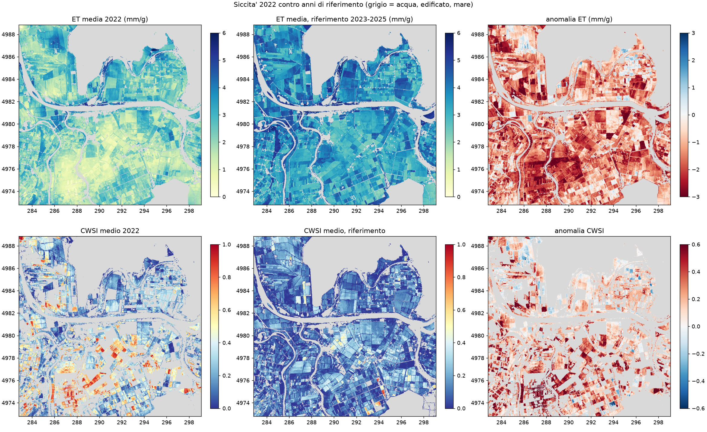
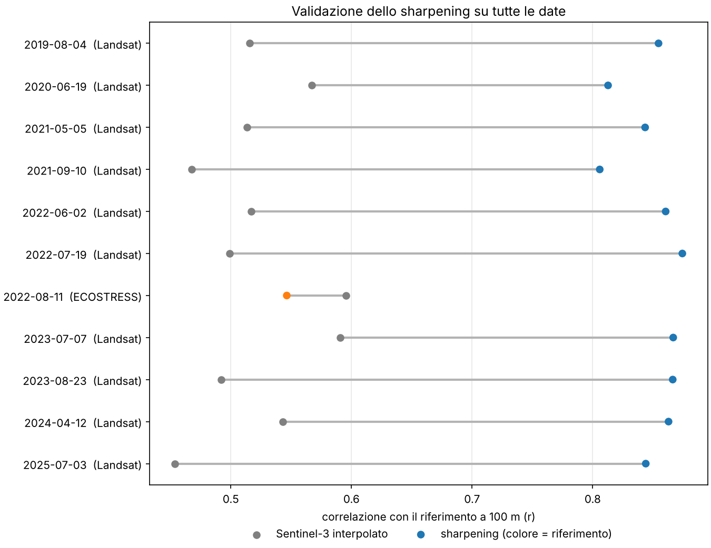
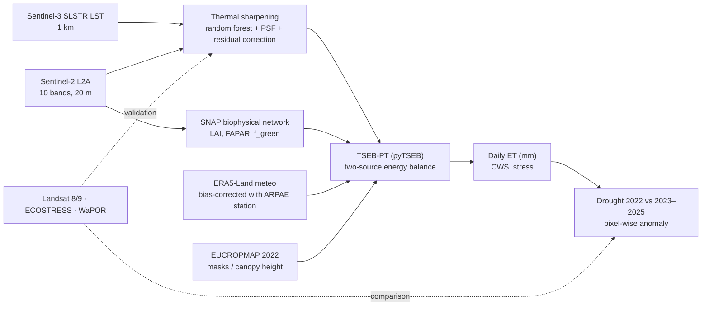

# eo_water — Field-scale water use and drought stress from Sentinel-2 + Sentinel-3

**How much water did the Po Delta's farmland stop evaporating during the 2022 drought, and where?**
This repository estimates daily evapotranspiration (ET) and crop water stress at **20 m** by
sharpening Sentinel-3 land surface temperature (1 km) with Sentinel-2, and feeding it into a
two-source energy balance model (TSEB). The method is validated on 10 independent Landsat
dates (2019–2025) and applied to the 2022 drought versus 2023–2025.

**Full technical report:** [reports/report_en.md](reports/report_en.md) ([PDF](reports/report_en.pdf), 7 pages).

*Study area: Po Delta (Porto Tolle, Italy), ~18,000 ha of farmland. Phase 1 of a larger project;
Phase 2 will add Sentinel-1 InSAR ground deformation.*

---

## Key results

| | |
| --- | --- |
| **Sharpening, 1 km → 20 m** (10 dates, 2019–2025, vs Landsat 8/9 at 100 m) | median r **0.51 → 0.86**, unbiased RMSE **3.1 → 2.0 K**, improved on **10/10** dates |
| **Summer 2022 ET vs 2023–2025** (June–August, 5 matched dates per year) | **−28 % to −39 %** (−1.0 to −1.4 mm/day), depending on the air-temperature correction; ≈ **17–23 million m³** less water evaporated over the summer |
| **Coast–inland gradient in 2022** | inland (4–8 km from the sea) / coast (0–2 km) ET ratio **0.81** in 2022 vs **≈1.00** in every other year; confirmed by a stress index that does not use air temperature |
| **Independent checks** | Sentinel-2 LAI −18 % in 2022 (model-free); FAO **WaPOR** L1: same sign (−6 % / −9 %), r = 0.47 at 300 m; **ECOSTRESS** at 500 m: LST r = 0.69, ET r = 0.61 |

<p align="center">
  <br>
  <em>Mean June–August ET and crop water stress index (CWSI): 2022 vs the 2023–2025 reference, 20 m.</em>
</p>

<p align="center">
  <br>
  <em>Sharpening validation against Landsat on 10 dates: grey = Sentinel-3 interpolated, blue = sharpened.</em>
</p>

---

## Method



1. **Thermal sharpening.** A random forest learns LST from 12 Sentinel-2 predictors (10 bands, NDVI, NDMI) at 1 km and predicts at 20 m. Two details matter:
   - **Sentinel-3 point spread function:** Sentinel-2 is blurred with a 500 m Gaussian before aggregation, which raised spatial R² from 0.35 to 0.46. A Landsat control experiment (R² 0.82) showed the limit was in the Sentinel-3 footprint, not in the predictors.
   - **Residual correction:** this keeps the 1 km Sentinel-3 mean, so only sub-kilometre detail is added.

   Model selection uses **spatial block cross-validation** (5 km blocks).
2. **Biophysics.** LAI, FCOVER and FAPAR come from the ESA SNAP neural network (Weiss & Baret 2016; SNAP coefficients v2.1), re-implemented in NumPy. The green fraction f_g = FAPAR/FIPAR stops stubble from "transpiring".
3. **Energy balance.** TSEB-PT (Norman et al. 1995; pyTSEB) gives Rn, H, LE and G for soil and canopy separately, and daily ET via the LE/solar-radiation ratio.
   - **ERA5-Land air temperature** is corrected with an ARPAE ground station. ERA5 was 2.1 K too cool at overpass on 19 July 2022.
   - **Canopy height:** two variants, from LAI (consistent across years) or from the 2022 crop map. Both are run as a sensitivity test.
4. **Water stress.** Two independent indices:
   - **CWSI from TSEB:** 1 − actual / potential (Priestley-Taylor) transpiration;
   - **a contextual index** that needs no air temperature.

   On developed canopies they agree on *which* fields are stressed (Spearman 0.84).
5. **Drought analysis.**
   - **Matched dates:** five clear-sky dates per summer, in the same seasonal windows.
   - **Reference years:** chosen on station-measured rainfall. ERA5-Land wrongly ranked 2023 as the driest spring.
   - **Anomaly:** pixel-wise against the median of 2023–2025, with sensitivity tests on canopy height and air-temperature correction.

---

## Limitations (stated honestly)

- **Five snapshots per summer, not a continuous series.** The seasonal volume is an order of magnitude only.
- **The anomaly magnitude depends on the air-temperature correction** (−28 % with a fixed correction, −39 % with daily station-based corrections). Absolute CWSI is especially sensitive, so between-year CWSI differences should be read with care. ET and the coastal gradient are robust.
- **WaPOR sees a much smaller 2022 anomaly (−6/−9 %)** than this method. Literature reports severe 2022 impacts in the Delta (saltwater intrusion > 40 km, ~60 % of rice production compromised), but ground ET measurements would be needed to settle the magnitude.
- **One ground station** (inland), and a crop map for 2022 only, while crops rotate.
- **ECOSTRESS scenes over the Delta in 2022 are much blurrier than their nominal 70 m**, so they are used at 500 m only.

---

## Reproduce

```bash
conda env create -f environment.yml
conda activate eo_water

# one date, full chain (Sentinel download via openEO, ERA5, sharpening, TSEB, stress)
python scripts/run_chain.py --date 2022-07-19 --altezza lai

# drought comparison and WaPOR check (dates listed in config/phase1_sharpening.yaml)
python scripts/p4_01_climate_context.py
python scripts/p4_02_drought_comparison.py --altezza lai
python scripts/p4_03_wapor.py --altezza lai
```

**Accounts needed (all free):**
- Copernicus Data Space (openEO);
- Copernicus Climate Data Store (`~/.cdsapirc`);
- NASA Earthdata (`~/_netrc`, ECOSTRESS only).

Credentials are never stored in the repository. All choices (areas, thresholds, dates, model parameters) are in **one file**, `config/phase1_sharpening.yaml`. Each date gets its own folders, so runs never overwrite each other.

| Folder / script | What it does |
| --- | --- |
| `p1_01` – `p1_05` | date search (cloud cover measured on the study area), download, training table, model comparison, sharpening and validation |
| `p2_01` – `p2_07` | ERA5-Land, SNAP biophysics, TSEB, station check, crop map, water stress |
| `p3_01` – `p3_03` | ECOSTRESS search and comparison, multi-date validation summary |
| `p4_01` – `p4_03` | climate context (with station rainfall check), drought comparison, WaPOR |
| `config_utils.py`, `run_chain.py` | date-parametrised configuration, chain runner |
| `PROJECT_LOG.md` | every decision, with its reason, and the open issues |

---

## Data and licences

| Data | Source | Licence / terms |
| --- | --- | --- |
| Sentinel-2 L2A, Sentinel-3 SLSTR LST | Copernicus, via Copernicus Data Space (openEO) | free and open; contains modified Copernicus Sentinel data 2019–2025 |
| Landsat 8/9 Collection 2 L2 | USGS, via Microsoft Planetary Computer | public domain |
| ERA5-Land | Copernicus Climate Change Service (C3S) | Copernicus licence; contains modified C3S information |
| EUCROPMAP 2022 | European Commission JRC | CC BY 4.0 |
| Station GIRALDA (Codigoro) | ARPAE-SIMC, Dext3r | CC BY 4.0 |
| ECOSTRESS v002 | NASA LP DAAC | NASA open data |
| WaPOR v3 L1 AETI | FAO | see FAO WaPOR terms of use |

**Code licence:** MIT (see [`LICENSE`](LICENSE)). The licence covers the code only; each dataset keeps its own terms listed above.

Raw and processed rasters are not in the repository (they are large and re-downloadable). Tables, figures and run summaries are in `outputs/`.

## Main references

- Norman, J.M., Kustas, W.P. & Humes, K.S. (1995). Source approach for estimating soil and vegetation energy fluxes in observations of directional radiometric surface temperature. *Agricultural and Forest Meteorology* 77(3–4), 263–293. https://doi.org/10.1016/0168-1923(95)02265-Y
- Guzinski, R. & Nieto, H. (2019). Evaluating the feasibility of using Sentinel-2 and Sentinel-3 satellites for high-resolution evapotranspiration estimations. *Remote Sensing of Environment* 221, 157–172. https://doi.org/10.1016/j.rse.2018.11.019
- Weiss, M. & Baret, F. (2016). *S2ToolBox Level 2 products: LAI, FAPAR, FCOVER*, Version 1.1. Algorithm Theoretical Basis Document, INRA / ESA (SNAP). Network coefficients: SNAP `s2tbx-biophysical` auxdata, version 2.1.
- d'Andrimont, R., Verhegghen, A., Lemoine, G., Kempeneers, P., Meroni, M. & van der Velde, M. (2021). From parcel to continental scale – A first European crop type map based on Sentinel-1 and LUCAS Copernicus in-situ observations. *Remote Sensing of Environment* 266, 112708. https://doi.org/10.1016/j.rse.2021.112708 (EUCROPMAP)
- Straffelini, E. & Tarolli, P. (2023). Climate change-induced aridity is affecting agriculture in Northeast Italy. *Agricultural Systems* 208, 103647. https://doi.org/10.1016/j.agsy.2023.103647

---

*Author: Giovanni MARINO — https://www.linkedin.com/in/giov-marino/ · Feedback and questions welcome via Issues.*
