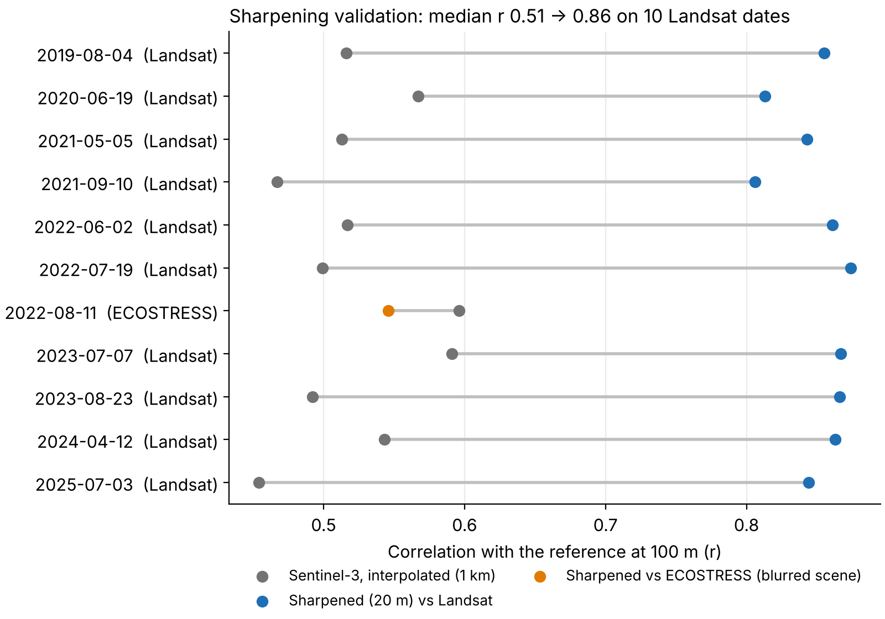
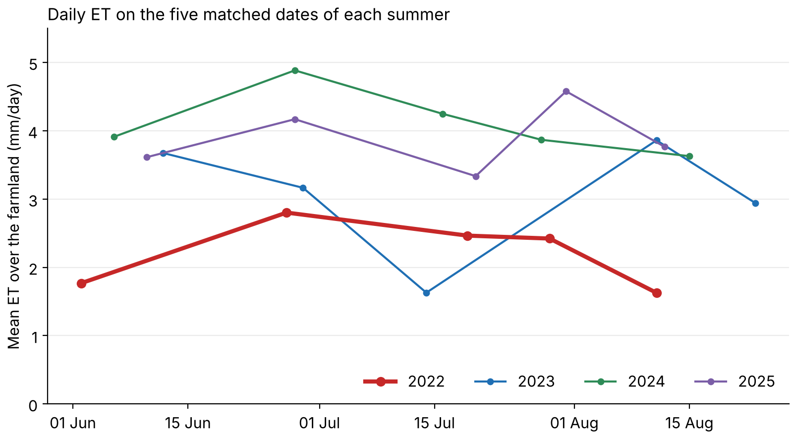
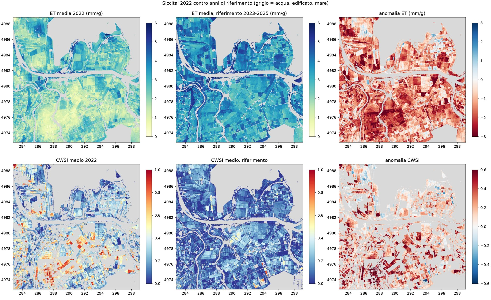
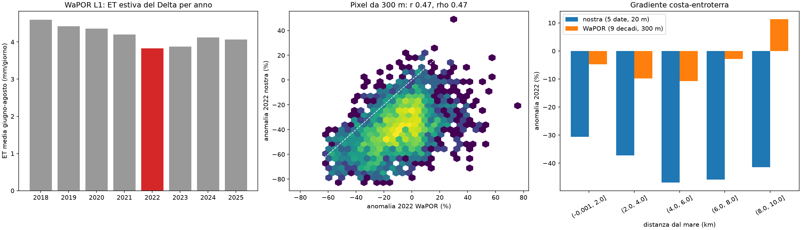

# Po Delta 2022 drought: field-scale evapotranspiration from Sentinel-2 and Sentinel-3

Giovanni Marino · November 2026

**In summer 2022 the Po Delta's farmland evaporated 28–39 % less water than in 2023–2025, about 17–23 million m³ over June–August, and the deficit was concentrated 4–8 km inland rather than on the coast.** These numbers come from daily evapotranspiration (ET) mapped at 20 m by combining Sentinel-3 thermal data with Sentinel-2. The sharpening step was validated on 10 independent Landsat dates.

## Question and study area

The question is how much water the farmland stopped evaporating during the 2022 drought, and where. ET is the water that leaves fields as vapour, from soil and from plants. When crops are short of water they close their stomata, transpire less and warm up. A satellite that measures surface temperature can therefore see water stress.

**Study area.** About 17,900 ha of farmland in the Po Delta around Porto Tolle (Rovigo, Italy), mostly annual crops (maize, soybean, wheat, a little rice), with alfalfa, grassland and poplar stands. The land lies below sea level and depends on river water pumped through reclamation canals.

**Why 2022.** It was the third driest January–July since 1991 in ERA5-Land (63 % of the 1991–2025 mean), and June–August was 2.1 K warmer than normal. The GIRALDA ground station recorded 184 mm of rain from January to July 2022, against 320–419 mm in 2023–2025. The Po reached record low flows, and salt water moved more than 40 km up the river ([Straffelini & Tarolli, 2023](https://doi.org/10.1016/j.agsy.2023.103647)).

**The technical problem.** Sentinel-3 measures land surface temperature (LST) every day, but at 1 km. One pixel covers dozens of fields. Sentinel-2 sees single fields at 10–20 m but has no thermal band. This work transfers the thermal information to the Sentinel-2 grid ("thermal sharpening") and then turns temperature into ET with an energy-balance model.

## Data

All inputs are free and open. Every source is re-downloaded by the scripts, so the raw data are not in the repository.

| Data | Resolution | Role | Source |
| --- | --- | --- | --- |
| Sentinel-3 SLSTR LST | 1 km, daily | temperature to sharpen | Copernicus Data Space (openEO) |
| Sentinel-2 L2A | 10–20 m, 5 days | predictors, LAI, FAPAR | Copernicus Data Space (openEO) |
| Landsat 8/9 Collection 2 L2 | 100 m thermal | independent validation of the sharpening | USGS, via Microsoft Planetary Computer |
| ERA5-Land | \~9 km, hourly | air temperature, wind, humidity, radiation | Copernicus Climate Change Service |
| ARPAE station GIRALDA (Codigoro) | point, hourly | air-temperature correction, rainfall | ARPAE-SIMC, Dext3r |
| EUCROPMAP 2022 | 10 m | crop types, masks, canopy height | European Commission JRC |
| ECOSTRESS v002 | 70 m nominal | second LST and ET reference | NASA LP DAAC |
| WaPOR v3 L1 AETI | 300 m, 10-day | independent ET product | FAO |

**Dates.** For the drought analysis, five clear-sky dates were chosen in each summer (2022–2025), in the same seasonal windows: early June, late June, mid-July, late July and mid-August. Cloud cover was measured on the study area itself, from the Landsat and Sentinel-2 cloud masks, not taken from the scene-level metadata.

## Method

The chain runs in five steps, one Python script each, all driven by one configuration file.

1. **Thermal sharpening (1 km → 20 m).** A random forest learns Sentinel-3 LST from 12 Sentinel-2 predictors (10 bands, NDVI, NDMI) aggregated to 1 km, then predicts at 20 m.
    - *Point spread function.* Before aggregation, Sentinel-2 is blurred with a 500 m Gaussian, so it "sees" like the Sentinel-3 sensor. This raised the spatial R² from 0.35 to 0.46. The same model trained on Landsat reached R² 0.82, which shows the limit is the Sentinel-3 footprint, not the predictors.
    - *Residual correction.* The 1 km residual is added back, so each 1 km block keeps its Sentinel-3 mean and only sub-kilometre detail is added.
    - *Model selection* uses spatial block cross-validation (5 km blocks), so the score is not inflated by neighbouring pixels.
2. **Vegetation variables.** LAI, FCOVER and FAPAR come from the ESA SNAP biophysical neural network (Weiss & Baret), re-implemented in NumPy. The green fraction f\_g = FAPAR / FIPAR, with FIPAR = 1 − exp(−k·LAI), separates green leaves from dry stubble that cannot transpire.
3. **Energy balance (TSEB-PT).** The two-source model of [Norman et al. (1995)](<https://doi.org/10.1016/0168-1923(95)02265-Y>), run with pyTSEB, splits the surface into soil and canopy and solves net radiation (Rn), sensible heat (H), latent heat (LE) and soil heat (G) for each. Daily ET scales the instantaneous LE by the ratio of daily to instantaneous solar radiation.
    - *Air temperature.* ERA5-Land was too cool at the overpass time (by 2.1 K on 19 July 2022). It is corrected each date against the GIRALDA station, from 0 to +3.5 K.
    - *Canopy height.* Two variants: from LAI only (consistent across years), or from typical heights per crop in the 2022 crop map. Both are reported.
4. **Water stress.** Two independent indices:
    - *CWSI from TSEB:* 1 − actual / potential transpiration, with Priestley-Taylor potential transpiration on the green canopy;
    - *a contextual index:* temperature scaled between the 2nd and 98th percentile within LAI classes. It does not use air temperature at all.

    On developed canopies they agree on which fields are stressed (Spearman 0.84).

5. **Drought design.** For each pixel, the five dates of a summer are averaged. 2022 is compared with the median of 2023, 2024 and 2025. The reference years were chosen on station rainfall: ERA5-Land wrongly ranked 2023 as the driest spring, while the station recorded 419 mm. Sensitivity runs change the canopy height and use one fixed air-temperature correction (+2 K) for every date.

## Validation

**On 10 independent Landsat dates (2019–2025, April to September), sharpening raised the median correlation with Landsat from 0.51 to 0.86 and cut the unbiased RMSE from 3.1 to 2.0 K.** It improved every one of the 10 dates. Landsat 8/9 passes over the Delta within minutes of Sentinel-3 and has its own thermal sensor, so it is a fair, independent reference. The comparison is made at 100 m, the native Landsat thermal resolution.

*Figure 1. Correlation with the reference at 100 m: grey = Sentinel-3 interpolated, blue = sharpened vs Landsat, orange = sharpened vs a blurred ECOSTRESS scene.*

The sharpened maps run 0.3–3.2 K cooler than Landsat on most dates. This offset is inherited from the Sentinel-3 product: the residual correction preserves its 1 km mean by design. A cool surface bias pushes TSEB towards higher ET. Since the same product and chain are used in every year, it should weigh more on absolute ET than on the 2022-vs-reference anomaly, but this has not been tested directly.

**ECOSTRESS.** On 11 August 2022, the only date without Landsat, ECOSTRESS was used instead. Its 2022 scenes over the Delta are much blurrier than their nominal 70 m, so at 70 m the sharpening appears not to help (r 0.60 → 0.55). Aggregated to 500 m, the sharpened LST agrees with ECOSTRESS at r = 0.69, and our daily ET with the ECOSTRESS PT-JPL ET at r = 0.61. The ECOSTRESS stress index (ESI) is built differently from CWSI and showed no agreement, so it is not used.

## Results: the 2022 drought

**Summer ET in 2022 was 28–39 % below the 2023–2025 reference, depending on how air temperature is corrected.** The drop is 1.0–1.4 mm per day over 17,895 ha. Over 92 days that is roughly 17–23 million m³ of water not evaporated: an order of magnitude only, because it rests on five snapshots per summer.

| Variant | Air-temperature correction | Canopy height | Mean ET 2022 (mm/day) | ET anomaly |
| --- | --- | --- | --- | --- |
| Main | station, per date | from LAI | 2.21 | −1.41 mm/day (−39 %) |
| Crop height | station, per date | from crop map | 2.40 | −1.34 mm/day (−36 %) |
| Fixed correction | +2 K on every date | from LAI | 2.57 | −1.01 mm/day (−28 %) |

The sign and the spatial pattern hold in all three variants. The size depends on the air-temperature correction: in 2022 the station correction was small on two dates (+0.5 and +1.0 K), which lowers 2022 ET in the main run.

*Figure 2. Mean daily ET over the farmland on the five matched dates of each summer (main variant). 2022 is the lowest on every date except mid-July, when ET was also low in 2023.*

**The deficit grew with distance from the sea.** Within 2 km of the coast ET fell by 30 %, at 4–8 km by 47 % (main variant). Date by date, the ratio of inland (4–8 km) to coastal (0–2 km) ET was 0.81 in 2022 and between 0.97 and 1.00 in every reference year. Three checks support a real effect rather than a model artefact:

- the contextual stress index, which uses no air temperature, shows the same gradient: its 2022 anomaly goes from −0.06 on the coast to +0.08 at 6–8 km;
- the gradient is the same in the fixed-correction run (ratio 0.81);
- ERA5-Land shows only a weak and constant inland warming (+0.14 K), the same in every year.

The cause is not established here. Candidates are the sea breeze keeping coastal fields cooler, and differences in water supply from the reclamation canals as the Po ran low.

*Figure 3. Mean June–August ET (top, mm/day) and CWSI (bottom) at 20 m: 2022, the 2023–2025 reference, and the anomaly. Grey = water, built-up land, sea. Coordinates in km, UTM 33N. Panel labels are in Italian.*

**Vegetation was less developed.** Mean summer LAI from Sentinel-2, which does not depend on TSEB or air temperature, was 1.34 in 2022 against 1.63, 1.71 and 1.51 in 2023–2025, about 18 % lower.

**WaPOR agrees on the sign, not on the size.** FAO WaPOR v3 (300 m, 10-day) gives 2022 the lowest summer ET of 2018–2025, 353 mm, but only 6 % below 2023–2025 (9 % below all other years). Pixel by pixel at 300 m, its anomaly correlates with ours at r = 0.47. WaPOR also shows a weaker drop on the coast (−5 %) than at 2–6 km (−10 %).

*Figure 4. Left: WaPOR summer ET per year (mm/day; 2022 in red). Centre: 2022 anomaly per 300 m pixel, WaPOR (x) vs this work (y). Right: 2022 anomaly by distance from the sea, this work (blue) vs WaPOR (orange). Panel labels are in Italian.*

**By land cover,** arable crops lost 39 %, alfalfa 42 % and grassland 43 %. Woodland, orchards and poplars lost 31 % in the main run and 41 % with crop-map heights, so that class is not robust.

## Limitations

- **Five snapshots per summer, not a continuous series.** The seasonal volume (17–23 million m³) is an order of magnitude.
- **The anomaly size depends on the air-temperature correction** (−28 % to −39 %). Absolute CWSI is even more sensitive: with a fixed +2 K correction, mean 2022 CWSI falls from 0.31 to 0.23, almost equal to 2023. Between-year CWSI differences should be read with care; ET and the coastal gradient are robust.
- **WaPOR sees a much smaller anomaly** (−6 %). Ground flux measurements (eddy covariance) would be needed to settle the size.
- **One ground station**, located inland, corrects air temperature for the whole area.
- **One crop map (2022)** for all years, while crops rotate. This is why the LAI-based canopy height is the main variant.
- **No ground truth for ET.** Validation covers the sharpened temperature; ET is checked only against other models (ECOSTRESS PT-JPL, WaPOR ETLook).

## Conclusions and next steps

Free Copernicus data can map field-scale ET and its drought anomaly with a reproducible open-source chain. Sharpening Sentinel-3 with Sentinel-2 recovers most of the field-scale thermal pattern seen by Landsat (median r 0.86). Applied to the Po Delta, the chain shows a large 2022 ET deficit with a clear inland gradient that two independent stress indices agree on.

Next steps:

1. Compare the inland gradient with the irrigation intakes and canal network of the reclamation consortia.
2. Add a continuous daily series (all clear Sentinel-3 days) to replace the five-snapshot estimate.
3. Phase 2: Sentinel-1 InSAR to map ground subsidence in the same area, linking surface water use to what happens below ground.

## References, data and code

- Norman, J.M., Kustas, W.P. & Humes, K.S. (1995). Source approach for estimating soil and vegetation energy fluxes in observations of directional radiometric surface temperature. *Agricultural and Forest Meteorology* 77(3–4), 263–293. [doi:10.1016/0168-1923(95)02265-Y](<https://doi.org/10.1016/0168-1923(95)02265-Y>)
- Guzinski, R. & Nieto, H. (2019). Evaluating the feasibility of using Sentinel-2 and Sentinel-3 satellites for high-resolution evapotranspiration estimations. *Remote Sensing of Environment* 221, 157–172. [doi:10.1016/j.rse.2018.11.019](https://doi.org/10.1016/j.rse.2018.11.019)
- Weiss, M. & Baret, F. (2016). *S2ToolBox Level 2 products: LAI, FAPAR, FCOVER*, Version 1.1. ATBD, INRA / ESA. SNAP network coefficients v2.1.
- d'Andrimont, R. et al. (2021). From parcel to continental scale – A first European crop type map based on Sentinel-1 and LUCAS Copernicus in-situ observations. *Remote Sensing of Environment* 266, 112708. [doi:10.1016/j.rse.2021.112708](https://doi.org/10.1016/j.rse.2021.112708)
- Straffelini, E. & Tarolli, P. (2023). Climate change-induced aridity is affecting agriculture in Northeast Italy. *Agricultural Systems* 208, 103647. [doi:10.1016/j.agsy.2023.103647](https://doi.org/10.1016/j.agsy.2023.103647)

**Data.** Contains modified Copernicus Sentinel data (2019–2025) and modified Copernicus Climate Change Service information. Landsat: USGS, public domain. EUCROPMAP and ARPAE data: CC BY 4.0. ECOSTRESS: NASA. WaPOR: FAO terms of use.

**Code.** Python, MIT licence, on GitHub (repository eo\_water). All parameters are in one configuration file, and every step can be re-run for any date.
